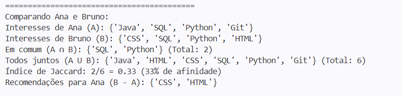
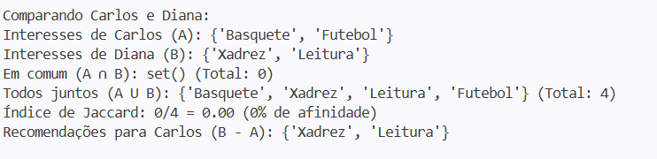
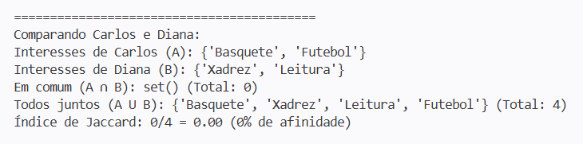

# Laboratório de Conjuntos e Conjuntos Numéricos

**Instituição:** Fatec Osasco  
**Curso:** Desenvolvimento de Software Multiplataforma (DSM)  
**Integrantes da Equipe:**  
- Miguel Pires de Oliveira
- Leonardo Samuel de Oliveira  

---

## 1. Apresentação e Decisões Tomadas

Este repositório contém a resolução prática do **Laboratório de Conjuntos**, dividido em três partes de complexidade progressiva utilizando a linguagem **Python**.

### Decisões de Implementação:
1. **Parte 1 (Teoria dos Conjuntos sem operadores nativos):**
   - Para cumprir o desafio de não utilizar os operadores prontos da linguagem (`set`), optamos por representar os conjuntos como **listas (`list`)**.
   - Logo na leitura dos dados (`ler_conjunto`), garantimos a propriedade fundamental dos conjuntos (ausência de elementos repetidos) percorrendo a entrada com um laço `for` e adicionando o elemento apenas se ele ainda não estiver na lista (`if item not in conjunto`).
   - Todas as operações (união, interseção, diferença, diferença simétrica, pertinência, inclusão e cardinalidade) foram construídas manualmente com laços `for` e condicionais `if/else`. Ao final de cada operação, convertemos as listas para `set` nativo apenas para exibir lado a lado e validar que a nossa lógica manual produz exatamente o mesmo resultado.

2. **Parte 2 (Classificador de Conjuntos Numéricos):**
   - Optamos por receber a entrada como texto (`string`), pois o usuário precisa digitar formatos variados como frações (`3/4`), dízimas periódicas (`0.333...`) e raízes (`raiz(2)`).
   - A classificação respeita a hierarquia de inclusão dos conjuntos: $\mathbb{N} \subset \mathbb{Z} \subset \mathbb{Q} \subset \mathbb{R}$, tratando os Irracionais ($\mathbb{I}$) como um conjunto disjunto de $\mathbb{Q}$ dentro dos Reais ($\mathbb{R}$).
   - Para a **fração geratriz**, criamos uma lógica que identifica o período que se repete após o ponto decimal, monta o denominador com algarismos `9` equivalentes ao tamanho do período e utiliza a função `math.gcd` (Máximo Divisor Comum) para simplificar a fração até sua forma irredutível.

3. **Parte 3 (Mini-projeto 1 — Sistema de Recomendação Simples):**
   - Escolhemos o sistema de recomendação baseado no **Índice de Jaccard**, pois demonstra de forma direta como a interseção e a união resolvem um problema real de afinidade entre usuários:
     $$J(A, B) = \frac{|A \cap B|}{|A \cup B|}$$
   - Além do cálculo de afinidade, utilizamos a operação de diferença ($B - A$) para sugerir novos itens ao usuário $A$ com base no que o usuário $B$ consome.

---

## 2. Como Executar os Programas

Certifique-se de ter o Python 3 instalado. No terminal, dentro da pasta do projeto, execute:

```bash
python parte1.py
python parte2.py
python parte3.py
```

---

## 3. Exemplos de Execução e Casos de Teste (Logs)

### Parte 1: Teoria dos Conjuntos

#### Caso de Teste 1: Entrada com elementos repetidos e conjuntos com interseção parcial
- **Entrada:** $U = \{1, 2, 3, 4, 5, 6\}$, $A = \{1, 2, 2, 3, 3\}$, $B = \{3, 4, 5\}$
- **Saída do Programa:**
```text
=== LABORATORIO DE CONJUNTOS - PARTE 1 ===


#### Caso de Teste 2: Conjuntos Disjuntos (sem elementos em comum)


#### Caso de Teste 3: Conjunto Vazio e Conjuntos Iguais


### Parte 2: Conjuntos Numéricos


---

### Parte 3: Sistema de Recomendação (Cálculos à Mão vs. Saída do Programa)

#### Cenário 1: Afinidade Parcial (Ana e Bruno)
- **Cálculo à mão:**
  - $A = \{\text{Python, Java, SQL, Git}\}$ e $B = \{\text{Python, SQL, HTML, CSS}\}$
  - Interseção: $A \cap B = \{\text{Python, SQL}\} \Rightarrow |A \cap B| = 2$
  - União: $A \cup B = \{\text{Python, Java, SQL, Git, HTML, CSS}\} \Rightarrow |A \cup B| = 6$
  - Índice de Jaccard: $J(A, B) = \frac{2}{6} \approx 0,33$ ($33\%$)
  - Recomendação para Ana ($B - A$): $\{\text{HTML, CSS}\}$
- **Saída do Programa:**



#### Cenário 2: Sem Afinidade / Conjuntos Disjuntos (Carlos e Diana)
- **Cálculo à mão:**
  - $A = \{\text{Futebol, Basquete}\}$ e $B = \{\text{Xadrez, Leitura}\}$
  - Interseção: $A \cap B = \emptyset \Rightarrow |A \cap B| = 0$
  - União: $|A \cup B| = 4$
  - Índice de Jaccard: $J(A, B) = \frac{0}{4} = 0,00$ ($0\%$)
- **Saída do Programa:**



#### Cenário 3: Afinidade Total / Conjuntos Iguais (Eduardo e Fernanda)
- **Cálculo à mão:**
  - $A = \{\text{Rock, MPB, Jazz}\}$ e $B = \{\text{Jazz, Rock, MPB}\}$
  - Interseção: $|A \cap B| = 3$ e União: $|A \cup B| = 3$
  - Índice de Jaccard: $J(A, B) = \frac{3}{3} = 1,00$ ($100\%$)
  - Recomendação para Eduardo ($B - A$): $\emptyset$
- **Saída do Programa:**

